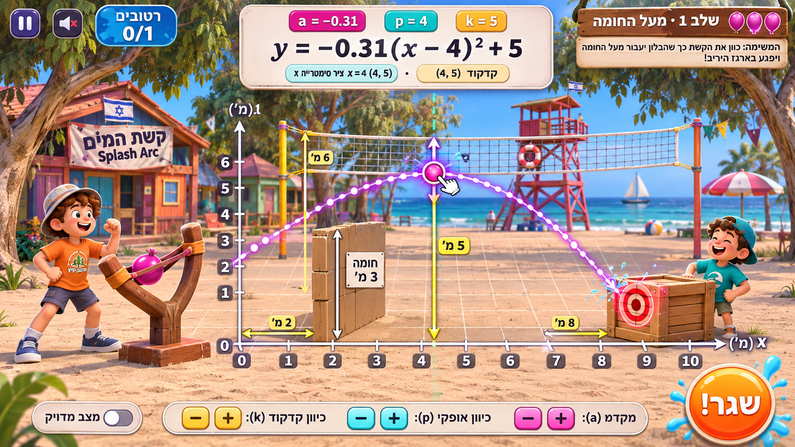
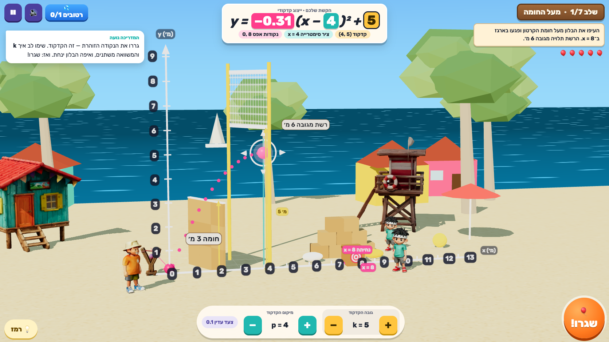
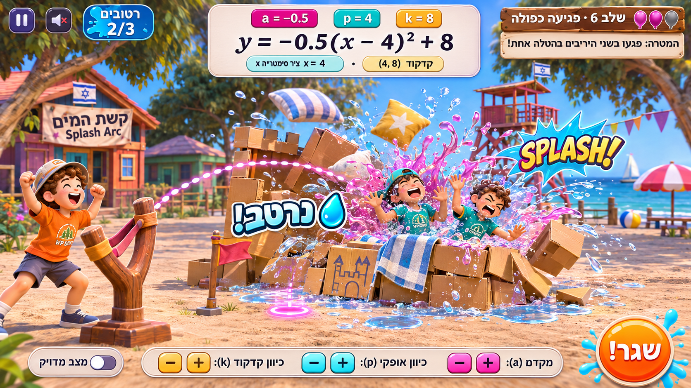
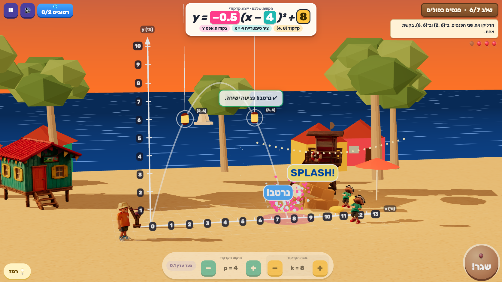
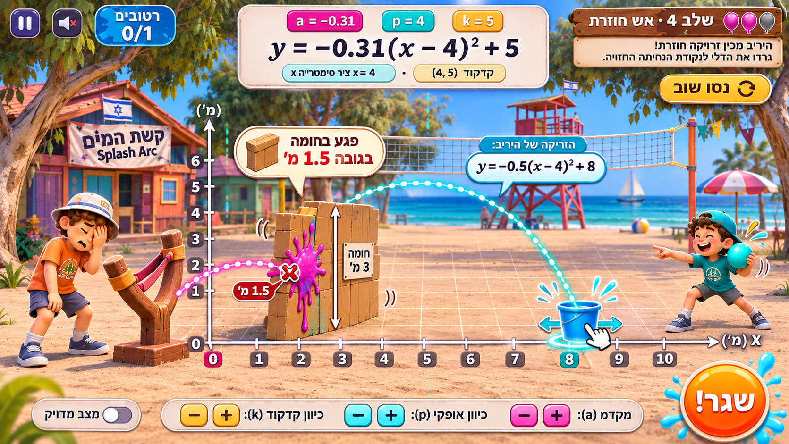
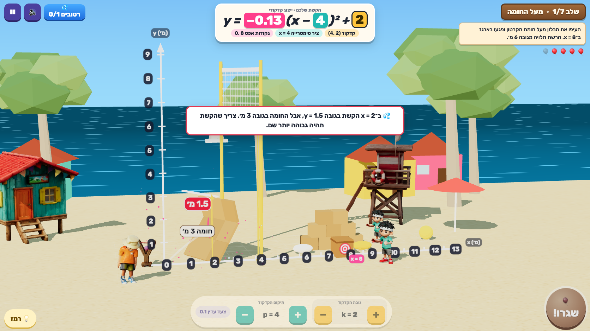
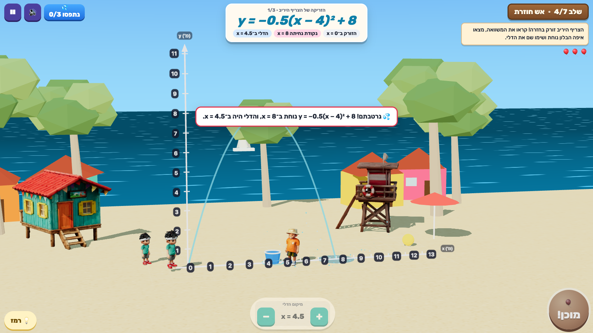
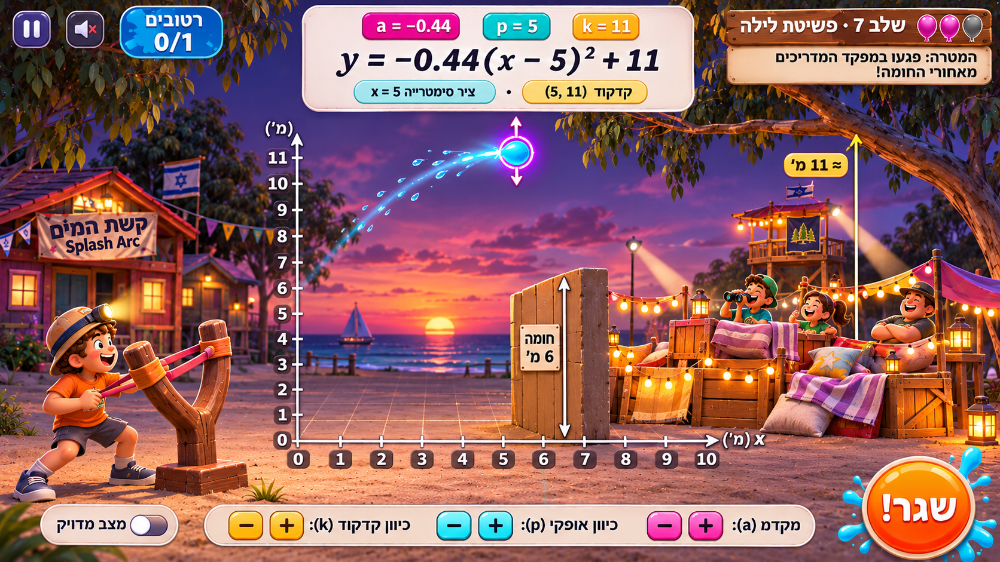
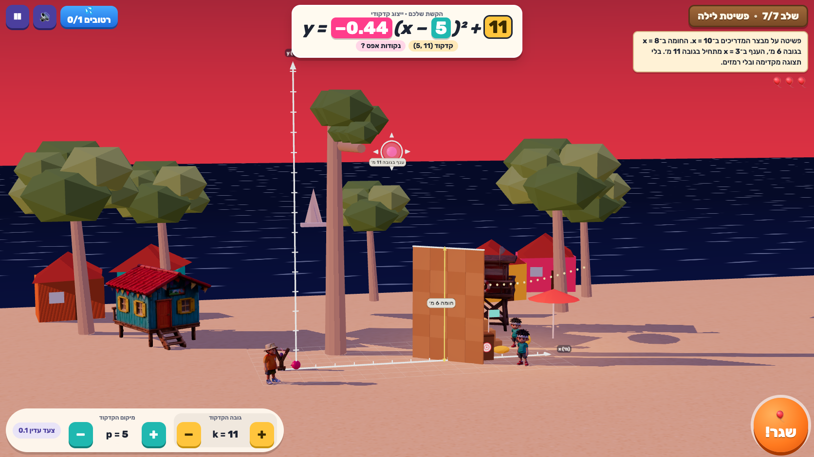

# Visual review — mockups vs real gameplay

Targets: ChatGPT gpt-image mockups in [`visual-targets/`](visual-targets/) (prompts in `PROMPTS.md`). They are design targets, not evidence. Actual: real gameplay captured by [`scripts/shots.mjs`](../scripts/shots.mjs) at the mockups' 1672×941 framing, in Chrome (headless, Playwright), with **real inputs**: mouse drags on the canvas to move the vertex handle and key presses (Space, arrows) to fire and move the bucket. The script only reads `render_game_to_text()` and projects a world point to find where the handle is on screen; it never injects a result. Captures are in [`captures/`](captures/) with the state log in `capture-log.json`.

| Target | Actual | State at capture |
|---|---|---|
|  |  | Level 1 after dragging the vertex from (4, 2) to (4, 5): `y = −0.31(x − 4)² + 5`, zeros 0 and 8 |
|  |  | Level 6, vertex (4, 8): both lanterns swiped, splash at x = 8, fort blocks flying |
|  |  | Level 1 default arc splats on the wall at `y(2) = 1.5` |
| (same target, return-fire half) |  | Level 4, bucket at 4.5 while `y = −0.5(x − 4)² + 8` lands at 8: our camper is soaked |
|  |  | Level 7 aimed at (5, 11), no preview, no grid numbers |

## What matches

- **Camera:** side-on view of the shot plane with a slight elevation and yaw, metre axes drawn in the world with dark number tiles, the slingshot at the origin on the left and the fort on the right. The parabola reads as a true parabola.
- **HUD hierarchy:** pause / mute / "רטובים n/m" splash badge top-left; the equation card top-centre with coloured `a` (magenta), `p` (teal) and `k` (yellow) tiles and chips for קדקוד, ציר סימטרייה and נקודות אפס; the wooden level sign with balloon icons and the parchment mission top-right; the wide ± pill bar at the bottom; the big orange **שגר!** button bottom-right. Colour coding of `a/p/k` matches the mockups and the world markers (yellow k bar, teal axis line, magenta handle and landing ring).
- **RTL typography:** Hebrew text is RTL; every formula, coordinate and number is an LTR isolate (`y = −0.31(x − 4)² + 5`, `x = 8`, `(4, 5)`), so minus signs and parentheses never flip. Rubik is bundled.
- **Set and props:** sunny Mediterranean beach, sea with moving bands, eucalyptus trees, colourful cabins, the Tripo stilt cabin and lifeguard tower, the Tripo slingshot, cardboard wall with the "חומה 3 מ׳" sign and a yellow height arrow, the volleyball net with "רשת מגובה 6 מ׳".
- **Feedback:** the glowing vertex handle with arrows, dotted preview, splash particles, "נרטב!" and "SPLASH!" pop-ups, a red height tag at the impact point ("1.5 מ׳") and a worked-explanation card ("ב־x = 2 הקשת בגובה y = 1.5, אבל החומה בגובה 3 מ׳"), the white trail of the real flight.

## Honest deviations

1. **Character scale.** The mockups show the campers as big foreground figures. In the game they stand at true-ish scale (≈2 m) in the field, so they read smaller. Making them giant would contradict the metre grid the math depends on. Kept deliberately; their animations still carry the reactions.
2. **Lifeguard tower colours.** The Tripo tower came out weathered brown rather than red-and-white. The level-3 launcher platform is procedural (red legs, wooden deck) because its height must be exactly 3 m.
3. **Wall thickness and orientation.** The mockup wall is a chunky block facing the camera. The game's cardboard wall is a thin panel turned about its exact x-line (`x = 2`), so the rule "the arc's height at x = 2" matches what you see; it reads as a wall from the side camera but is thinner than in the mockup.
4. **Night raid.** The mockup's counselors' fort is a large lit set with lanterns. The game's level 7 shows a 6 m wall that hides most of the fort behind it, string lights and a dusk sky; it is less lavish.
5. **Rival return fire inside shooting levels.** Mockup 3 shows return fire and a wall splat on the same screen. In the game they are separate (level 1 wall, level 4 return fire).
6. **`a` nudge buttons.** The mockup's bottom bar includes ± for `a`. The game derives `a` from the vertex and the launcher (`a = (h − k)/p²`), so the `a` tile explains that instead of nudging it; ± exist for `k` and `p`.
7. **Grid on the sand** is fainter than in the mockups.

## Other sizes checked

In the built-in browser: 1280×720, phone portrait 375×812 (HUD stacks, field smaller, a "rotate for a bigger field" tip on the title screen) and phone landscape 812×375 (compact HUD). Console clean (no errors) once all Tripo models are present.
